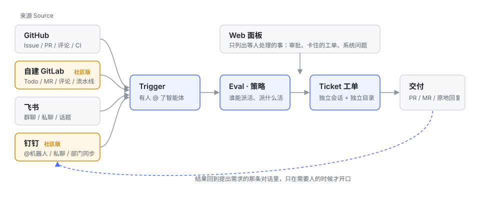

# open-superagent

[简体中文](README.md) · English

**A community-maintained fork of [deepseek-ai/dsh-superagent-prototype](https://github.com/deepseek-ai/dsh-superagent-prototype) that adds a self-hosted GitLab Source and a DingTalk Source.** It is not affiliated with DeepSeek. The upstream repository does not accept outside contributions, so this fork carries them and merges upstream regularly. See the [comparison with upstream](README.md#为什么要有社区版) and the [CHANGELOG](CHANGELOG.md).



The upstream notice below still applies:

> **Research prototype for reference only, not an official DeepSeek product.** This code grew out of our team's day-to-day development work, with much of the engineering done by coding agents. Treat it as research code, not production-ready software. It may still contain bugs, and its coding style and engineering practices may be inconsistent. Review and adapt it before using it in your own environment.
>
> We have adapted it for publication, so it is not identical to our internal version or the implementation described in *Exploring Super-agent Design: Towards a More Autonomous Agent System*. Some designs discussed in the article are directions for future development and are not implemented in this prototype.

dsh-superagent is a proactive coding agent for one repository, packaged as a bundle for [DeepSeek Harness](https://www.deepseek.com/en/harness/). It listens to GitHub or a self-hosted GitLab and, optionally, to Feishu and DingTalk chats. When someone allowed asks the agent for work, it opens a work item, works on it in its own agent session and directory, and answers in the original conversation, for example with a pull request. A web panel shows what needs a person.

It is also a way of working with an agent: **take as little human attention as possible, and give as much value as possible.** An agent that can act for a whole team can also waste a whole team's attention, so it acts only when asked or when a rule the team wrote allows it, and speaks only when someone must act or can use a result. [docs/000-philosophy.md](docs/000-philosophy.md) explains the principle and what it asks of the operator.

## Setup

Setup has many steps, so an agent does it with you. Ask your coding agent:

> Read SETUP.md in this repository and set up dsh-superagent with me.

```sh
git clone https://github.com/chunonesoft/open-superagent.git
cd open-superagent && pnpm install && pnpm check
```

It asks one short question at a time, shows the full plan once, and then installs and configures everything. [SETUP.md](SETUP.md) is what it follows.

## Documentation

Read the numbered documents in order; each builds only on the ones before it.

- [000 Philosophy](docs/000-philosophy.md)
- [001 Domain model](docs/001-domain.md)
- [002 Authorization](docs/002-authorization.md)
- [003 Execution](docs/003-execution.md)
- [004 Prompts](docs/004-prompts.md)
- [005 Panel](docs/005-panel.md)
- [006 Deployment](docs/006-deployment.md): manual setup, configuration, upgrades and troubleshooting
- [007 Architecture](docs/007-architecture.md)
- [008 Cookbook](docs/008-cookbook.md): adding a Source

## Development

`pnpm check` runs the typecheck, the tests and the build.

## Contributing

Issues and pull requests are welcome, especially new Sources (WeCom, Gitee, Gitea, ...). See [CONTRIBUTING.md](CONTRIBUTING.md).

## License

[MIT](LICENSE). The original copyright of the DeepSeek Harness Team is kept.
